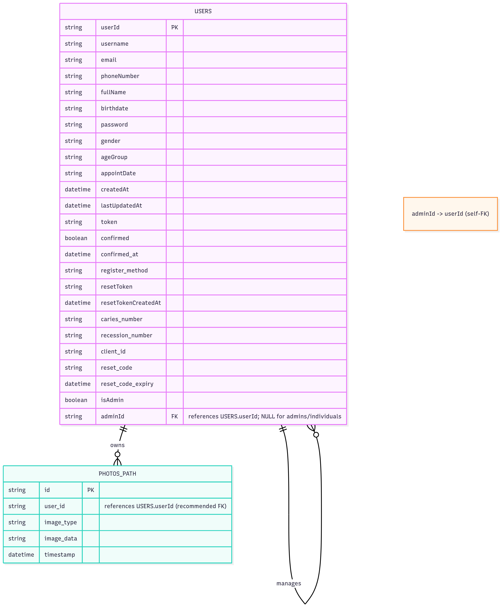
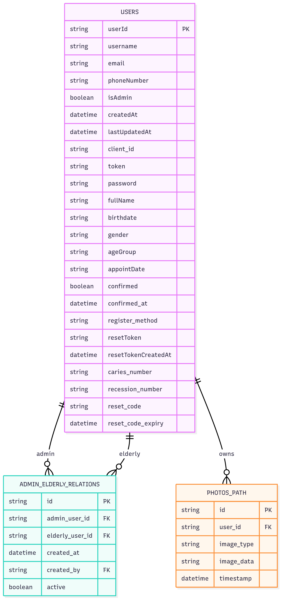

# Admin-managed Multi-Account Design (Elderly users)

This document compares two designs to let an Admin create and manage N elderly accounts where elderly never log in nor run analysis. The Admin performs all actions on their behalf.

## Scenario & Constraints
- Admin user can create and control N elderly accounts.
- Elderly do not log in; Admin authenticates and acts on their behalf.
- Current DB uses a single `Users` table and a `photos_path` table (no FK).
- Assume email uniqueness (recommended to enforce at DB level).

## What you’ll find here
- Feasibility, performance, maintenance, and implementation difficulty for two solutions
- Concrete schemas, indexes, SQL migrations, auth checks, and query patterns
- Rollout/migration steps and testing guidance

---

## Solution 1 — Single table with adminId + isAdmin (no new tables)

Keep a single `Users` table and add two columns:
- `isAdmin` (bool): whether the user is an admin
- `adminId` (string, FK → `Users.userId`): the admin managing this user (NULL if the row is an admin or an unmanaged individual)

Important: Do NOT store `listUsers` as a JSON/array. It breaks normalization and complicates integrity, performance, and concurrency. The `adminId` self-FK already gives you the one-to-many mapping you need.

### Schema changes
```sql
ALTER TABLE "Users"
  ADD COLUMN isAdmin BOOLEAN NOT NULL DEFAULT FALSE,
  ADD COLUMN adminId VARCHAR NULL;

-- Email should be unique per account (recommended)
ALTER TABLE "Users"
  ADD CONSTRAINT users_email_unique UNIQUE (email);

-- Self-referential FK for integrity
ALTER TABLE "Users"
  ADD CONSTRAINT users_admin_fk
  FOREIGN KEY (adminId) REFERENCES "Users"(userId)
  ON DELETE SET NULL;

-- Optional: forbid admins from being managed by someone else
ALTER TABLE "Users"
  ADD CONSTRAINT users_adminid_null_if_admin
  CHECK (CASE WHEN isAdmin THEN adminId IS NULL ELSE TRUE END);

-- Optional: forbid self-management
ALTER TABLE "Users"
  ADD CONSTRAINT users_not_self_managed
  CHECK (adminId IS NULL OR adminId <> userId);
```

### Indexes (performance)
```sql
-- List elderly for an admin quickly
CREATE INDEX users_adminid_idx ON "Users" (adminId);

-- Token lookups already exist in app logic; ensure userId index is present (PK covers it)
-- Optional partial index to speed queries over managed users
-- CREATE INDEX users_adminid_non_admin_idx ON "Users" (adminId) WHERE isAdmin = FALSE;
```

### Core query patterns
- Check permission (admin can act on an elderly):
```sql
SELECT 1
FROM "Users"
WHERE userId = :elderlyId
  AND adminId = :adminId
LIMIT 1;
```
- List elderly for an admin:
```sql
SELECT *
FROM "Users"
WHERE adminId = :adminId
ORDER BY createdAt DESC
LIMIT :limit OFFSET :offset;
```
- Create elderly under an admin (server-side creates passwordless elderly or a system-generated password):
```sql
INSERT INTO "Users" (userId, username, email, phoneNumber, isAdmin, adminId, createdAt, lastUpdatedAt)
VALUES (:id, :username, :email, :phone, FALSE, :adminId, now(), now());
```

### Authorization (pseudocode)
```python
def verify_admin_token(token) -> admin_id:
    user = fetch_user_by_token(token)
    if not user or not user.isAdmin:
        raise HTTPException(401, "Admin access required")
    return user.userId

def verify_admin_controls_elderly(admin_id, elderly_id) -> bool:
    return exists_user_where(userId=elderly_id, adminId=admin_id)
```
- For any endpoint like analyze on behalf of elderly: allow only if `verify_admin_controls_elderly` is true.

### Time/space complexity & latency
- Permission check: O(log N) with index on `(adminId)`, effectively constant-time in practice.
- List managed users: O(k) where k = managed count; index supports fast filtering + pagination.
- Create N users: O(N) inserts.
- No joins; single-table lookups are cheap.

### Maintenance
- Low. One table, clear model. Easy to reason about and extend for simple use-cases.
- Limitation: supports only one admin per elderly. If you need multiple admins later, you’ll need a relation table and a migration.

### Implementation difficulty
- Low. Add columns, constraints, indexes; update controller logic for admin checks; adjust endpoints to accept a `target_user_id` when acting on behalf.

### Testing checklist
- Admin can create/list elderly; non-admin cannot.
- Admin can analyze on behalf of owned elderly; cannot for others.
- Orphan behavior: deleting an admin sets `adminId` to NULL on managed users.
- Email uniqueness enforced.

### When is this best?
- You’re sure each elderly will have at most one admin.
- You want the simplest production-ready path with minimal migrations.

---

## Solution 2 — Add one relation table (recommended for scalability)

Introduce a join table to explicitly track admin ↔ elderly relationships. This supports 1:N and N:M cleanly and enables richer auditing.

### New table: `admin_elderly_relations`
```sql
CREATE TABLE admin_elderly_relations (
  id            VARCHAR PRIMARY KEY,
  admin_user_id VARCHAR NOT NULL REFERENCES "Users"(userId) ON DELETE CASCADE,
  elderly_user_id VARCHAR NOT NULL REFERENCES "Users"(userId) ON DELETE CASCADE,
  created_at    TIMESTAMP NOT NULL DEFAULT now(),
  created_by    VARCHAR NULL REFERENCES "Users"(userId),
  active        BOOLEAN NOT NULL DEFAULT TRUE,
  UNIQUE (admin_user_id, elderly_user_id)
);

-- Indexes for fast checks and listings
CREATE INDEX aer_admin_idx ON admin_elderly_relations (admin_user_id) WHERE active = TRUE;
CREATE INDEX aer_elderly_idx ON admin_elderly_relations (elderly_user_id) WHERE active = TRUE;
```

Optionally keep `Users.isAdmin` to label admins explicitly:
```sql
ALTER TABLE "Users"
  ADD COLUMN isAdmin BOOLEAN NOT NULL DEFAULT FALSE;
```

### Core query patterns
- Check permission (admin→elderly):
```sql
SELECT 1
FROM admin_elderly_relations
WHERE admin_user_id = :adminId
  AND elderly_user_id = :elderlyId
  AND active = TRUE
LIMIT 1;
```
- List elderly for an admin:
```sql
SELECT u.*
FROM admin_elderly_relations r
JOIN "Users" u ON u.userId = r.elderly_user_id
WHERE r.admin_user_id = :adminId AND r.active = TRUE
ORDER BY u.createdAt DESC
LIMIT :limit OFFSET :offset;
```
- Assign elderly to admin:
```sql
INSERT INTO admin_elderly_relations (id, admin_user_id, elderly_user_id)
VALUES (:id, :adminId, :elderlyId)
ON CONFLICT (admin_user_id, elderly_user_id) DO NOTHING;
```
- Remove/revoke access:
```sql
UPDATE admin_elderly_relations
SET active = FALSE
WHERE admin_user_id = :adminId AND elderly_user_id = :elderlyId;
```

### Authorization (pseudocode)
```python
def verify_admin_token(token) -> admin_id:
    user = fetch_user_by_token(token)
    if not user or not user.isAdmin:
        raise HTTPException(401, "Admin access required")
    return user.userId

def verify_admin_controls_elderly(admin_id, elderly_id) -> bool:
    return relation_exists(admin_id, elderly_id, active=True)
```

### Time/space complexity & latency
- Permission check: O(log N) on indexed `(admin_user_id, elderly_user_id)`; effectively constant-time.
- List managed users: O(k) with indexed relation + join; scales well.
- Create N users and relationships: O(N) inserts.
- Slight cost of a join compared to Solution 1, but negligible with indexes.

### Maintenance
- Low. Fully normalized; referential integrity guaranteed by FKs.
- Extensible: multiple admins per elderly, audit trail (`created_by`, timestamps), soft revocation (`active`), future fields (roles, scopes, facility_id) without table contortions.

### Implementation difficulty
- Moderate. Requires creating one new table and updating authorization queries. Still straightforward and clean.

### Testing checklist
- Multiple admins can manage the same elderly (if desired).
- Revoking relationship blocks access immediately.
- Deleting admin or elderly cascades to relations.
- No duplicate relations due to UNIQUE constraint.

### When is this best?
- You may need multiple admins per elderly now or later.
- You want clean authorization, auditing, and future growth (facilities, roles).

---

## API surface (both solutions)

- Admin login: unchanged; must set `isAdmin = TRUE` for admin accounts.
- Admin creates elderly:
  - S1: create `Users` row with `isAdmin = FALSE`, `adminId = :adminId`.
  - S2: create `Users` row, then insert relation row `admin_elderly_relations`.
- Admin acts on behalf:
  - Endpoints must accept a `target_user_id` (elderly) and pass admin’s token.
  - Server authorizes via Solution 1 or 2 check before performing operations (e.g., analyze, update, retrieve).
- Elderly login not required; omit password or generate internal-only credential.

---

## Performance notes
- Add pagination and narrow SELECT lists for `list elderly`.
- Keep hot indexes (`adminId`, relation keys) and VACUUM/ANALYZE healthy.
- For high write volume, batch inserts and reuse connections.
- Optional: add partial indexes using `WHERE active = TRUE` to keep them small.

---

## Migration & rollout

### Solution 1
1. Add columns + constraints.
2. Backfill `isAdmin` (FALSE by default; TRUE for admin accounts).
3. Set `adminId` for existing elderly where applicable.
4. Create indexes.
5. Deploy app changes (auth checks, endpoints accept `target_user_id`).

### Solution 2
1. Create `admin_elderly_relations` table + indexes.
2. Backfill relations from any existing mapping (if you’ve used `client_id` or similar, derive pairs).
3. Mark admins with `isAdmin = TRUE`.
4. Deploy app changes (auth checks using relation).

Deployment tip (PostgreSQL): if running on large tables, consider `CREATE INDEX CONCURRENTLY` (cannot run inside a transaction).

---

## Pros/Cons summary

- Solution 1 (adminId + isAdmin)
  - Pros: simplest, fast lookups, minimal changes.
  - Cons: one admin per elderly, less flexible for future roles, no many-to-many.

- Solution 2 (relation table)
  - Pros: normalized, scalable (many-to-many), audit-friendly, future-proof.
  - Cons: adds a join, requires table migration, slightly more initial work.

---

## Recommendation
- If you’re confident that each elderly will only ever have one admin and you want the quickest production path: choose Solution 1 and skip any `listUsers` JSON/array idea.
- If you want clean growth to multiple admins, facilities, and auditing with minimal rework later: choose Solution 2 now.

Both designs meet your current scenario (admin does everything). Solution 2 is generally the better long-term investment.

---

## ERDs (Mermaid)

### Solution 1 — Single table with adminId + isAdmin


### Solution 2 — Relation table (admin_elderly_relations)


---

## Summarized Comparison Table

| Dimension | Solution 1: adminId + isAdmin (single table) | Solution 2: Relation table |
|---|---|---|
| Feasibility | High | High |
| Auth check complexity | Very low (single SELECT on Users) | Low (single SELECT on relation; simple JOIN for lists) |
| Latency/Performance | O(log N) lookups; no join | O(log N) lookups; one small join for lists |
| Scalability | One-admin-per-elderly only | Many-to-many; easy to extend |
| Data integrity | Good with self-FK; simpler but less flexible | Excellent with FKs; normalized |
| Maintenance | Low for simple cases; harder to evolve | Low overall; easier to evolve and audit |
| Audit trail | Minimal (must add columns/logs) | Natural via relation (created_at/created_by/active) |
| Migration effort | Minimal | Moderate (add table + code paths) |
| Best for | Quick production path, simple ownership | Long-term, multi-admin, facilities, auditing |

---

## Operational Flows (login, register, analyze) and Impact of Unique Username

This section captures exactly how the common flows behave under each solution and what changes if `username` becomes unique.

### Baseline assumptions
- Admin authenticates and acts on behalf of elderly; elderly never log in.
- Email is unique (enforced at DB level) and is used for admin login by default in current code.
- Photos save/read continue using `photos_path.user_id` (recommend adding FK to `Users.userId`).

### Flow A — Login (Admin only)
- Endpoint: POST /login (existing)
- Authn: By email + password → issue JWT with `userId` and `exp`
- Authz downstream: Check `isAdmin` before allowing "on-behalf" actions

Implementation deltas:
- Solution 1: No change to login payload. After fetching by email, ensure `user.isAdmin == TRUE`.
- Solution 2: Same as S1; `isAdmin` lives on `Users` for convenience; relation table is not used for admin login.

Performance: Single indexed lookup by email; O(log N). Same for S1 and S2.

### Flow B — Register (Admin creates elderly)
- Endpoint: POST /admin/elderly (new) or reuse existing register with admin token
- Inputs: minimally username, email (optional if internal accounts), phone (optional), metadata
- Outputs: created elderly `userId`

Implementation deltas:
- Solution 1:
  1) Insert into `Users` with `isAdmin = FALSE`, `adminId = :adminId`. O(1) with indexes.
  2) Optional: generate internal password or set `password = NULL` if elderly never log in.

- Solution 2:
  1) Insert into `Users` (elderly). O(1).
  2) Insert into `admin_elderly_relations (admin_user_id, elderly_user_id)`; `active = TRUE`. O(1).

Performance: Both are O(1) per user; batch creation is O(n) and dominated by inserts.

### Flow C — Analyze (Admin acts on behalf of elderly)
- Endpoint: POST /analysis or POST /admin/elderly/{elderlyId}/analyze
- Inputs: admin JWT, `target_user_id` (elderly), image
- Steps (server):
  1) Verify admin token → `adminId`.
  2) Authorization check that admin controls `target_user_id`.
  3) Read/Write: fetch elderly user record; write analysis artifacts; update user history fields if applicable.

Authorization check:
- Solution 1: `SELECT 1 FROM Users WHERE userId=:elderlyId AND adminId=:adminId LIMIT 1` (index on adminId). O(log N).
- Solution 2: `SELECT 1 FROM admin_elderly_relations WHERE admin_user_id=:adminId AND elderly_user_id=:elderlyId AND active=TRUE LIMIT 1` (index). O(log N).

Writes (both):
- Save to `masks/{elderlyId}/...` and/or insert into `photos_path` with `user_id = elderlyId`.
- Recommend: `ALTER TABLE photos_path ADD FOREIGN KEY (user_id) REFERENCES "Users"(userId)` for integrity.

Latency summary for analyze:
- S1 avoids a join; single-table permission check.
- S2 does a narrow-table lookup; also practically sub-ms.
- YOLO inference dominates latency; DB lookups are negligible in both.

### Large Dataset Performance Notes
- Permission check: S1 (Users by PK + adminId) and S2 (relation table by indexed keys) are both O(log N) and sub-ms with proper indexes.
- Listing managed elderly: S1 filters Users by `adminId`; S2 scans a narrow relation by `admin_user_id` then PK-joins to Users. Both O(k). S2 can be more cache-friendly at very large scales.
- Writes: Similar O(1) per op. S2 adds one extra insert/update for the relation.

### Impact of Making `username` Unique
What changes if `Users.username` becomes UNIQUE?

- Database:
  - Add: `ALTER TABLE "Users" ADD CONSTRAINT users_username_unique UNIQUE (username);`
  - Add index is implicit via unique constraint; inserts/updates must ensure uniqueness.

- Login:
  - If you continue logging in by email (current code), nothing else changes.
  - If you switch to login by username, you gain unambiguous lookup; performance O(log N) either way.

- Register (Admin creates elderly):
  - Must generate globally unique usernames for elderly (e.g., `elderly_{adminShortId}_{seq}` or UUID suffix).
  - Both S1 and S2 unaffected functionally; only the insert validation changes to respect uniqueness.

- Analyze / Authorization:
  - No change. Both S1 and S2 checks are on `userId`/relations; independent of username.

- Maintenance:
  - Slightly better ergonomics if you sometimes identify users by username.
  - Minimal overhead: a unique index adds negligible cost at insert time; lookups remain fast.

Bottom line:
- Making `username` unique does not change the authorization or data-path logic in either solution.
- It only affects registration (must ensure uniqueness) and optionally enables username-based login.

---

## Self-referential FK (self-FK) in practice and fit for this system

How often it occurs
- Common in relational designs for 1→N hierarchies within the same table: employee→manager, category→parent, comment→parent, region→parent.
- A standard “adjacency list” pattern. Not suited for many-to-many.

When it’s a good practice here
- Good if all are true:
  - Each elderly has at most one admin (strict 1:N).
  - Structure is essentially two levels (admin → elderly) without complex trees.
  - Minimal need for relationship auditing/history.

Pros
- Simple schema, no joins for permission checks; fast with index on `adminId`.
- Minimal migration and application change; easy to ship.

Cons
- No many-to-many (can’t assign multiple admins to one elderly).
- Limited auditing (who assigned/revoked, when) unless extra logging.
- Less flexible if introducing facilities, delegation, or temporary coverage later.
- Requires guardrails to prevent cycles/self-management.

Recommended guardrails (DDL)
```sql
-- Columns (Solution 1)
ALTER TABLE "Users"
  ADD COLUMN isAdmin BOOLEAN NOT NULL DEFAULT FALSE,
  ADD COLUMN adminId VARCHAR NULL,
  ADD CONSTRAINT users_admin_fk FOREIGN KEY (adminId) REFERENCES "Users"(userId) ON DELETE SET NULL,
  ADD CONSTRAINT users_adminid_null_if_admin CHECK (CASE WHEN isAdmin THEN adminId IS NULL ELSE TRUE END),
  ADD CONSTRAINT users_not_self_managed CHECK (adminId IS NULL OR adminId <> userId);

CREATE INDEX users_adminid_idx ON "Users" (adminId);
```

Deletion policy
- Prefer `ON DELETE SET NULL` for `adminId` so managed users aren’t orphaned to invalid admin references.
- Application can block admin deletion if they still manage users, or reassign first.

Recommendation
- For MVP with guaranteed one-admin-per-elderly: self-FK is acceptable and common; implement with the guardrails above.
- For production with likely multi-admin, auditing, or future facility scope: use the relation table (Solution 2).
