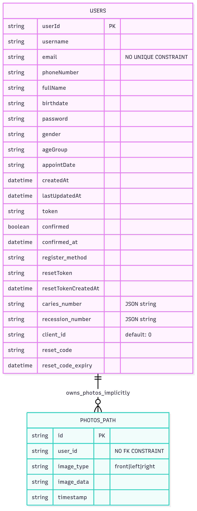
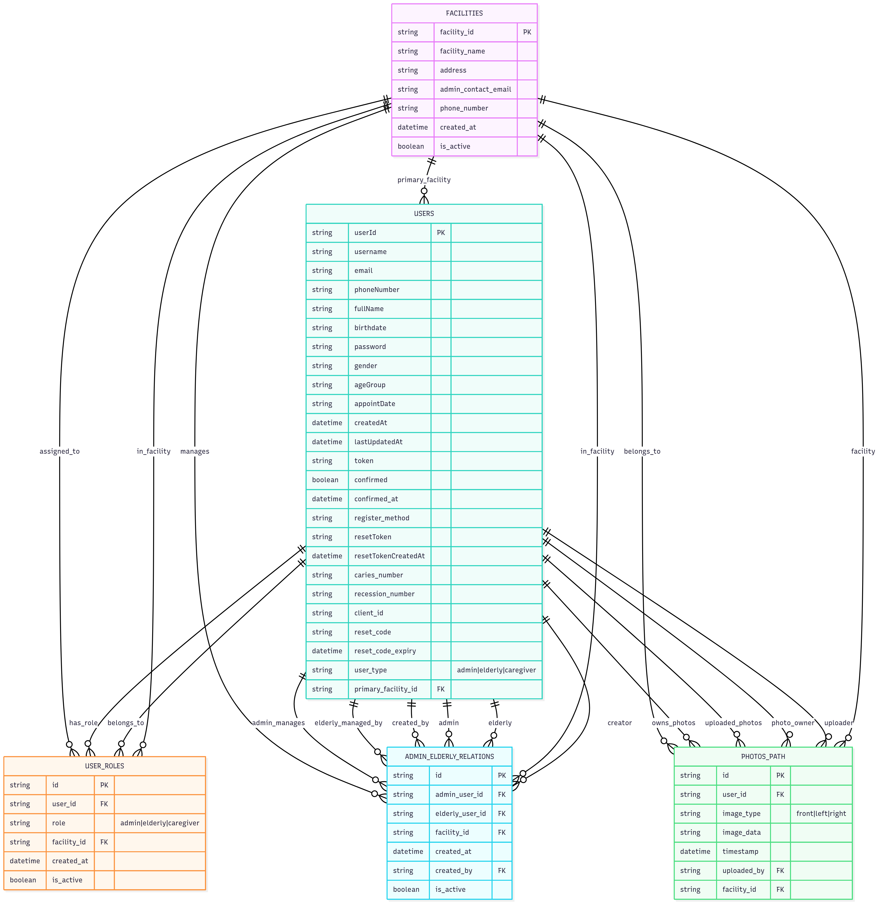

# Myoral.ai Database Schema Analysis and Multi-User Implementation Guide

## Table of Contents
1. [Current Database Schema](#current-database-schema)
2. [Authorization Logic Analysis](#authorization-logic-analysis)
3. [Problems with Duplicate Emails](#problems-with-duplicate-emails)
4. [Implementation Approach 1: No Schema Changes](#implementation-approach-1-no-schema-changes)
5. [Implementation Approach 2: Adding Proper Schema](#implementation-approach-2-adding-proper-schema)
6. [Recommendations](#recommendations)
7. [Code Examples](#code-examples)

## Current Database Schema

### Users Table (`Users`)
```python
class User(Base):
    __tablename__ = "Users"
    
    # Primary Key
    userId = Column(String, primary_key=True, index=True)
    
    # Required Fields
    username = Column(String, nullable=False)
    email = Column(String, nullable=False)  # NO UNIQUE CONSTRAINT
    phoneNumber = Column(String, nullable=False)
    
    # Optional Personal Info (nullable for Google login testing)
    fullName = Column(String, nullable=True)
    birthdate = Column(String, nullable=True)
    password = Column(String, nullable=True)
    gender = Column(String, nullable=True)
    ageGroup = Column(String, nullable=True)
    appointDate = Column(String, nullable=True)
    
    # System Fields
    createdAt = Column(DateTime, default=datetime.utcnow)
    lastUpdatedAt = Column(DateTime, default=datetime.utcnow, onupdate=datetime.utcnow)
    token = Column(String, nullable=True)
    
    # Email Verification
    confirmed = Column(Boolean, default=False)
    confirmed_at = Column(DateTime, nullable=True)
    register_method = Column(String, nullable=True)
    
    # Password Reset
    resetToken = Column(String, nullable=True)
    resetTokenCreatedAt = Column(DateTime, nullable=True)
    reset_code = Column(String(6), nullable=True)
    reset_code_expiry = Column(DateTime, nullable=True)
    
    # Medical Data
    caries_number = Column(String, nullable=True)  # JSON string
    recession_number = Column(String, nullable=True)  # JSON string
    
    # Multi-tenant Field (underutilized)
    client_id = Column(String, nullable=False, default="0")
```

### Photos Table (`photos_path`)
```python
class Photo(Base):
    __tablename__ = 'photos_path'
    
    id = Column(String, primary_key=True, index=True)
    user_id = Column(String)  # NO FOREIGN KEY CONSTRAINT
    image_type = Column(String)  # 'front', 'left', 'right'
    image_data = Column(String)  # Store image data
    timestamp = Column(String)
```

### Current Relationships
- **Implicit One-to-Many**: `User.userId` ← `Photo.user_id` (no formal FK)
- **No Admin-Elderly relationships**
- **No Facility/House concept**

### Current Schema ERD (Mermaid)
### Entity Relationship Diagram


**Issues with Current Schema:**
- No foreign key constraints
- No unique constraint on email (allows duplicates)
- No admin/elderly user distinction
- No facility/house management
- Implicit relationships only
- No audit trail or access control

## Authorization Logic Analysis

### Current Authentication Pattern
```python
def verify_token(credentials: HTTPAuthorizationCredentials, db: Session):
    token = credentials.credentials
    user = fetch_user_by_token(token, db)
    if not user:
        raise HTTPException(status_code=401, detail="Invalid or expired token")
    return user.userId
```

### Authorization Patterns Found

#### Pattern A: Self-Access Only with Reviewer Exception
**File**: `routers/retrieve.py`
```python
if current_user_id != userId and (not current_user or current_user.usertype != "reviewer"):
    raise HTTPException(status_code=403, detail="Not allowed to view other users' info")
```
**Issues**: 
- References `usertype` field that doesn't exist in schema
- Hardcoded "reviewer" role

#### Pattern B: No Authorization (CRITICAL VULNERABILITY)
**File**: `routers/analyze.py`
```python
async def analyze_photos(
    image: UploadFile = File(...),
    userId: str = Form("0", description="User ID")  # Anyone can pass any userId!
):
```
**Issues**:
- No token verification
- No permission checks
- Anyone can analyze photos for any user

#### Pattern C: Token Required, No Cross-Reference
**File**: `routers/update.py`
```python
def update_user_info(
    userId: str,
    current_user_id: str = Depends(verify_token),  # Only checks token validity
    # Missing: check if current_user_id == userId
):
```

### Critical Security Vulnerabilities

1. **Open Analysis Endpoint**: `/analysis` accepts any `userId` without verification
2. **Missing Authorization**: Most endpoints don't verify user relationships
3. **Inconsistent Patterns**: Different auth logic across endpoints
4. **No Admin Concept**: No way to distinguish admin vs elderly users
5. **No Audit Trail**: No logging of who accessed what data

## Problems with Duplicate Emails

### Database Issues
1. **Constraint Violations**: If unique constraint exists on email
2. **First Match Only**: `fetch_user_by_email()` returns `.first()` - always same user
3. **Orphaned Data**: No foreign key constraints

### Authentication Problems
```python
# Current login logic
user = fetch_user_by_email(login.email, db)  # Always returns first user
```
**Result**: Impossible to login as second+ users with same email

### Password Reset Chaos
```python
# Current reset logic
user = db.query(User).filter(User.email == email).first()  # Wrong user
```
**Result**: Reset tokens sent for wrong user account

### Email Communication Issues
- Confirmation emails go to wrong user context
- No way to distinguish which user account
- System notifications lack proper context

## Implementation Approach 1: No Schema Changes

### Overview
Keep current schema, handle multiple users with same email through application logic.

### Required Database Function Changes

```python
# Add to database.py

def fetch_user_by_email_and_client_id(email: str, client_id: str, db):
    """Fetch user by email and facility/client ID"""
    return db.query(User).filter(User.email == email, User.client_id == client_id).first()

def fetch_users_by_email(email: str, db):
    """Fetch all users with the same email - for admin managing multiple elderly"""
    return db.query(User).filter(User.email == email).all()

def fetch_user_by_email_and_username(email: str, username: str, db):
    """Alternative: use email + username combination for unique identification"""
    return db.query(User).filter(User.email == email, User.username == username).first()

def fetch_elderly_by_admin_email(admin_email: str, db):
    """Get all elderly users managed by admin with this email"""
    return db.query(User).filter(User.email == admin_email, User.ageGroup == "elderly").all()
```

### Login Logic Changes

#### Option A: Email + Client ID Login
```python
class UserLogin(BaseModel):
    email: str
    password: str
    client_id: str  # Add facility identifier

def login_user(login: UserLogin, db: Session = Depends(get_db)):
    user = fetch_user_by_email_and_client_id(login.email, login.client_id, db)
    if not user:
        raise HTTPException(status_code=401, detail="User not found")
    # Continue with password verification...
```

#### Option B: Email + Username Login
```python
class UserLogin(BaseModel):
    email: str
    username: str  # Add username as secondary identifier
    password: str

def login_user(login: UserLogin, db: Session = Depends(get_db)):
    user = fetch_user_by_email_and_username(login.email, login.username, db)
    # Continue with auth logic...
```

### Password Reset Handling
```python
def reset_password_request(data: PasswordResetRequest, db: Session = Depends(get_db)):
    users = fetch_users_by_email(data.email, db)  # Get ALL users
    
    if not users:
        return {"message": "If this email is registered, a reset link has been sent."}
    
    # Send reset links for all users with this email
    for user in users:
        reset_token = jwt.encode({
            "userId": user.userId,
            "client_id": user.client_id,  # Include context
            "exp": datetime.utcnow() + timedelta(hours=1)
        }, SECRET_KEY, algorithm=ALGORITHM)
        
        reset_url = f"{base_url}/reset-password?token={reset_token}"
        subject = f"Reset password for {user.username} (Facility: {user.client_id})"
        send_email(user.email, subject, email_body)
```

### Registration Changes
```python
def register_user(user: UserRegistration, db: Session = Depends(get_db)):
    # Generate unique username for same email
    if not user.username:
        user.username = f"elderly_{user.client_id}_{uuid.uuid4().hex[:8]}"
    
    # Check for duplicate email + username
    existing = fetch_user_by_email_and_username(user.email, user.username, db)
    if existing:
        raise HTTPException(400, "User with this email and username already exists")
    
    # Continue registration...
```

### Authorization Logic
```python
def verify_admin_access(elderly_user_id: str, admin_token: str, db: Session):
    admin_user = fetch_user_by_token(admin_token, db)
    elderly_user = fetch_user_by_id(elderly_user_id, db)
    
    if not admin_user or not elderly_user:
        raise HTTPException(401, "Invalid users")
    
    # Check if admin and elderly share same email (admin relationship)
    if admin_user.email != elderly_user.email:
        raise HTTPException(403, "Not authorized to access this user")
    
    # Check facility match
    if admin_user.client_id != elderly_user.client_id:
        raise HTTPException(403, "Not authorized for this facility")
    
    return True
```

### Frontend Requirements
- Collect `client_id` or `username` during login
- Handle user context switching for admins
- Pass proper user identifiers in API calls

### Pros and Cons

**Pros:**
- ✅ No database migration required
- ✅ Quick implementation (1-2 days)
- ✅ Uses existing `client_id` field
- ✅ Minimal code changes

**Cons:**
- ❌ Complex authentication logic
- ❌ Confusing user experience
- ❌ Error-prone authorization
- ❌ Password reset complications
- ❌ No formal relationship tracking
- ❌ Breaks email-based features
- ❌ Not scalable
- ❌ Security vulnerabilities

## Implementation Approach 2: Adding Proper Schema

### Overview
Add proper tables for facilities, user roles, and admin-elderly relationships.

### Entity Relationship Diagram



### Relationship Explanations

1. **FACILITIES ↔ USERS**: One facility can have multiple users, each user belongs to one primary facility
2. **FACILITIES ↔ USER_ROLES**: One facility can have multiple user roles, each role is assigned to one facility
3. **USERS ↔ USER_ROLES**: One user can have multiple roles (e.g., admin in multiple facilities), each role belongs to one user
4. **ADMIN_ELDERLY_RELATIONS**: Junction table managing which admin can access which elderly user
5. **PHOTOS_PATH**: Enhanced with proper foreign keys and audit trail (who uploaded what)

### Key Features of This Design

- **Multi-tenancy**: Facilities isolate data between different houses/organizations
- **Role-based Access**: Users can have different roles in different facilities
- **Audit Trail**: Track who uploaded photos and who created relationships
- **Flexible Permissions**: Admin-elderly relationships can be managed independently
- **Data Integrity**: Proper foreign key constraints ensure data consistency

### New Database Schema

#### Facilities Table
```python
class Facility(Base):
    __tablename__ = "facilities"
    
    facility_id = Column(String, primary_key=True)
    facility_name = Column(String, nullable=False)
    address = Column(String, nullable=True)
    admin_contact_email = Column(String, nullable=False)
    phone_number = Column(String, nullable=True)
    created_at = Column(DateTime, default=datetime.utcnow)
    is_active = Column(Boolean, default=True)
```

#### User Roles Table
```python
class UserRole(Base):
    __tablename__ = "user_roles"
    
    id = Column(String, primary_key=True)
    user_id = Column(String, ForeignKey("Users.userId"), nullable=False)
    role = Column(String, nullable=False)  # "admin", "caregiver", "elderly"
    facility_id = Column(String, ForeignKey("facilities.facility_id"), nullable=False)
    created_at = Column(DateTime, default=datetime.utcnow)
    is_active = Column(Boolean, default=True)
    
    # Relationships
    user = relationship("User", back_populates="roles")
    facility = relationship("Facility", back_populates="user_roles")
```

#### Admin-Elderly Relationships
```python
class AdminElderlyRelation(Base):
    __tablename__ = "admin_elderly_relations"
    
    id = Column(String, primary_key=True)
    admin_user_id = Column(String, ForeignKey("Users.userId"), nullable=False)
    elderly_user_id = Column(String, ForeignKey("Users.userId"), nullable=False)
    facility_id = Column(String, ForeignKey("facilities.facility_id"), nullable=False)
    created_at = Column(DateTime, default=datetime.utcnow)
    created_by = Column(String, ForeignKey("Users.userId"), nullable=True)
    is_active = Column(Boolean, default=True)
    
    # Relationships
    admin = relationship("User", foreign_keys=[admin_user_id])
    elderly = relationship("User", foreign_keys=[elderly_user_id])
    facility = relationship("Facility")
```

#### Modified User Table
```python
class User(Base):
    __tablename__ = "Users"
    
    # ... existing fields ...
    
    # New fields for multi-user support
    user_type = Column(String, nullable=False, default="elderly")  # "admin", "elderly", "caregiver"
    primary_facility_id = Column(String, ForeignKey("facilities.facility_id"), nullable=True)
    
    # Relationships
    roles = relationship("UserRole", back_populates="user")
    primary_facility = relationship("Facility")
    managed_elderly = relationship("AdminElderlyRelation", foreign_keys="AdminElderlyRelation.admin_user_id")
```

#### Enhanced Photos Table
```python
class Photo(Base):
    __tablename__ = 'photos_path'
    
    id = Column(String, primary_key=True, index=True)
    user_id = Column(String, ForeignKey("Users.userId"), nullable=False)  # Proper FK
    image_type = Column(String, nullable=False)  # 'front', 'left', 'right'
    image_data = Column(String, nullable=False)
    timestamp = Column(DateTime, default=datetime.utcnow)
    uploaded_by = Column(String, ForeignKey("Users.userId"), nullable=True)  # Who uploaded
    facility_id = Column(String, ForeignKey("facilities.facility_id"), nullable=True)
    
    # Relationships
    user = relationship("User", foreign_keys=[user_id])
    uploader = relationship("User", foreign_keys=[uploaded_by])
    facility = relationship("Facility")
```

### New Database Functions

```python
# Facility operations
def create_facility(facility_data: dict, db: Session):
    facility = Facility(**facility_data)
    db.add(facility)
    db.commit()
    return facility

def fetch_facility_by_id(facility_id: str, db: Session):
    return db.query(Facility).filter(Facility.facility_id == facility_id).first()

# User role operations
def assign_user_role(user_id: str, role: str, facility_id: str, db: Session):
    user_role = UserRole(
        id=str(uuid.uuid4()),
        user_id=user_id,
        role=role,
        facility_id=facility_id
    )
    db.add(user_role)
    db.commit()
    return user_role

def fetch_users_by_role_and_facility(role: str, facility_id: str, db: Session):
    return db.query(User).join(UserRole).filter(
        UserRole.role == role,
        UserRole.facility_id == facility_id,
        UserRole.is_active == True
    ).all()

# Admin-elderly relationships
def create_admin_elderly_relation(admin_id: str, elderly_id: str, facility_id: str, db: Session):
    relation = AdminElderlyRelation(
        id=str(uuid.uuid4()),
        admin_user_id=admin_id,
        elderly_user_id=elderly_id,
        facility_id=facility_id
    )
    db.add(relation)
    db.commit()
    return relation

def fetch_elderly_by_admin(admin_user_id: str, db: Session):
    return db.query(User).join(AdminElderlyRelation).filter(
        AdminElderlyRelation.admin_user_id == admin_user_id,
        AdminElderlyRelation.is_active == True
    ).all()

def verify_admin_elderly_access(admin_id: str, elderly_id: str, db: Session):
    relation = db.query(AdminElderlyRelation).filter(
        AdminElderlyRelation.admin_user_id == admin_id,
        AdminElderlyRelation.elderly_user_id == elderly_id,
        AdminElderlyRelation.is_active == True
    ).first()
    return relation is not None
```

### New API Endpoints

#### Admin Management
```python
# Admin login
@router.post("/admin/login")
def admin_login(login: AdminLogin, db: Session = Depends(get_db)):
    user = fetch_user_by_email(login.email, db)
    if not user or user.user_type != "admin":
        raise HTTPException(401, "Invalid admin credentials")
    # Continue with authentication...

# List managed elderly
@router.get("/admin/elderly")
def list_managed_elderly(
    current_admin_id: str = Depends(verify_admin_token),
    db: Session = Depends(get_db)
):
    elderly_users = fetch_elderly_by_admin(current_admin_id, db)
    return {"elderly": elderly_users}

# Admin analyze elderly photos
@router.post("/admin/elderly/{elderly_id}/analyze")
def admin_analyze_elderly(
    elderly_id: str,
    image: UploadFile = File(...),
    current_admin_id: str = Depends(verify_admin_token),
    db: Session = Depends(get_db)
):
    # Verify admin can access this elderly
    if not verify_admin_elderly_access(current_admin_id, elderly_id, db):
        raise HTTPException(403, "Not authorized to access this elderly user")
    
    # Continue with analysis...
```

#### Enhanced Authorization
```python
def verify_admin_token(credentials: HTTPAuthorizationCredentials = Depends(security), db: Session = Depends(get_db)):
    token = credentials.credentials
    user = fetch_user_by_token(token, db)
    if not user or user.user_type != "admin":
        raise HTTPException(401, "Admin access required")
    return user.userId

def verify_elderly_token(credentials: HTTPAuthorizationCredentials = Depends(security), db: Session = Depends(get_db)):
    token = credentials.credentials
    user = fetch_user_by_token(token, db)
    if not user or user.user_type != "elderly":
        raise HTTPException(401, "Elderly user access required")
    return user.userId

def verify_admin_or_self_access(
    target_user_id: str,
    current_user_id: str = Depends(verify_token),
    db: Session = Depends(get_db)
):
    current_user = fetch_user_by_id(current_user_id, db)
    
    # Allow self-access
    if current_user_id == target_user_id:
        return True
    
    # Allow admin access to managed elderly
    if current_user.user_type == "admin":
        return verify_admin_elderly_access(current_user_id, target_user_id, db)
    
    raise HTTPException(403, "Access denied")
```

### Database Migration Script

```sql
-- Create facilities table
CREATE TABLE facilities (
    facility_id VARCHAR PRIMARY KEY,
    facility_name VARCHAR NOT NULL,
    address VARCHAR,
    admin_contact_email VARCHAR NOT NULL,
    phone_number VARCHAR,
    created_at TIMESTAMP DEFAULT CURRENT_TIMESTAMP,
    is_active BOOLEAN DEFAULT TRUE
);

-- Create user_roles table
CREATE TABLE user_roles (
    id VARCHAR PRIMARY KEY,
    user_id VARCHAR NOT NULL REFERENCES "Users"(userId),
    role VARCHAR NOT NULL,
    facility_id VARCHAR NOT NULL REFERENCES facilities(facility_id),
    created_at TIMESTAMP DEFAULT CURRENT_TIMESTAMP,
    is_active BOOLEAN DEFAULT TRUE
);

-- Create admin_elderly_relations table
CREATE TABLE admin_elderly_relations (
    id VARCHAR PRIMARY KEY,
    admin_user_id VARCHAR NOT NULL REFERENCES "Users"(userId),
    elderly_user_id VARCHAR NOT NULL REFERENCES "Users"(userId),
    facility_id VARCHAR NOT NULL REFERENCES facilities(facility_id),
    created_at TIMESTAMP DEFAULT CURRENT_TIMESTAMP,
    created_by VARCHAR REFERENCES "Users"(userId),
    is_active BOOLEAN DEFAULT TRUE
);

-- Add new columns to Users table
ALTER TABLE "Users" ADD COLUMN user_type VARCHAR DEFAULT 'elderly';
ALTER TABLE "Users" ADD COLUMN primary_facility_id VARCHAR REFERENCES facilities(facility_id);

-- Add proper foreign key to photos_path
ALTER TABLE photos_path ADD CONSTRAINT fk_user_id 
    FOREIGN KEY (user_id) REFERENCES "Users"(userId);
ALTER TABLE photos_path ADD COLUMN uploaded_by VARCHAR REFERENCES "Users"(userId);
ALTER TABLE photos_path ADD COLUMN facility_id VARCHAR REFERENCES facilities(facility_id);
ALTER TABLE photos_path ALTER COLUMN timestamp TYPE TIMESTAMP USING timestamp::timestamp;

-- Create indexes for performance
CREATE INDEX idx_user_roles_user_facility ON user_roles(user_id, facility_id);
CREATE INDEX idx_admin_elderly_admin ON admin_elderly_relations(admin_user_id);
CREATE INDEX idx_admin_elderly_elderly ON admin_elderly_relations(elderly_user_id);
CREATE INDEX idx_photos_user_id ON photos_path(user_id);
CREATE INDEX idx_users_facility ON "Users"(primary_facility_id);
```

### Pros and Cons

**Pros:**
- ✅ Proper role-based access control
- ✅ Clear admin-elderly relationships
- ✅ Scalable to multiple facilities
- ✅ Audit trail and compliance ready
- ✅ Clean separation of concerns
- ✅ Standard authentication patterns
- ✅ Each user has unique email
- ✅ Formal relationship tracking
- ✅ Database integrity with foreign keys
- ✅ Production-ready security

**Cons:**
- ❌ Requires database migration
- ❌ More complex initial setup (1 week)
- ❌ Need to update existing APIs
- ❌ More tables to manage
- ❌ Existing data needs migration

## Recommendations

### For Development/Testing
- **Use Approach 1** if you need a quick prototype
- Timeline: 1-2 days
- Good for proof of concept

### For Production
- **Use Approach 2** for any real-world deployment
- Timeline: 1 week initial setup
- Essential for healthcare applications requiring:
  - Security compliance
  - Audit trails
  - Multi-facility support
  - Proper user management

### Migration Path
1. **Phase 1**: Implement Approach 1 for immediate needs
2. **Phase 2**: Plan and execute migration to Approach 2
3. **Phase 3**: Add advanced features (notifications, reporting, etc.)

## Code Examples

### Current Login (Problematic)
```python
# routers/login.py - Current implementation
def login_user(login: UserLogin, db: Session = Depends(get_db)):
    user = fetch_user_by_email(login.email, db)  # Problem: always first user
    if not user:
        raise HTTPException(status_code=401, detail="User not found")
    # ... rest of login
```

### Approach 1: Modified Login
```python
# Modified login requiring client_id
class UserLogin(BaseModel):
    email: str
    password: str
    client_id: str

def login_user(login: UserLogin, db: Session = Depends(get_db)):
    user = fetch_user_by_email_and_client_id(login.email, login.client_id, db)
    if not user:
        raise HTTPException(status_code=401, detail="User not found")
    # ... rest of login
```

### Approach 2: Role-Based Login
```python
# Separate admin and elderly login
@router.post("/admin/login")
def admin_login(login: UserLogin, db: Session = Depends(get_db)):
    user = fetch_user_by_email(login.email, db)
    if not user or user.user_type != "admin":
        raise HTTPException(401, "Invalid admin credentials")
    # ... admin-specific login logic

@router.post("/elderly/login")
def elderly_login(login: UserLogin, db: Session = Depends(get_db)):
    user = fetch_user_by_email(login.email, db)
    if not user or user.user_type != "elderly":
        raise HTTPException(401, "Invalid elderly credentials")
    # ... elderly-specific login logic
```

### Current Analyze (Vulnerable)
```python
# routers/analyze.py - Current vulnerable implementation
async def analyze_photos(
    image: UploadFile = File(...),
    userId: str = Form("0", description="User ID")  # No verification!
):
    # Anyone can analyze photos for any user
```

### Approach 1: Basic Fix
```python
async def analyze_photos(
    image: UploadFile = File(...),
    userId: str = Form(...),
    current_user_id: str = Depends(verify_token),
    db: Session = Depends(get_db)
):
    # Basic check - same email or admin
    current_user = fetch_user_by_id(current_user_id, db)
    target_user = fetch_user_by_id(userId, db)
    
    if current_user.email != target_user.email:
        raise HTTPException(403, "Not authorized")
    # ... analysis logic
```

### Approach 2: Proper Authorization
```python
@router.post("/elderly/{elderly_id}/analyze")
async def analyze_elderly_photos(
    elderly_id: str,
    image: UploadFile = File(...),
    current_user_id: str = Depends(verify_token),
    db: Session = Depends(get_db)
):
    # Verify admin-elderly relationship
    if not verify_admin_elderly_access(current_user_id, elderly_id, db):
        raise HTTPException(403, "Not authorized to analyze this user's photos")
    
    # Log the access for audit
    log_access(current_user_id, elderly_id, "photo_analysis", db)
    
    # ... analysis logic
```

---

## Implementation Checklist

### Approach 1 Checklist
- [ ] Add new database functions
- [ ] Modify login endpoint
- [ ] Update password reset logic
- [ ] Fix analyze endpoint authorization
- [ ] Update registration logic
- [ ] Modify frontend login form
- [ ] Test with multiple users same email
- [ ] Document workarounds

### Approach 2 Checklist
- [ ] Design new database schema
- [ ] Write migration scripts
- [ ] Create new database models
- [ ] Implement new database functions
- [ ] Create admin/elderly endpoints
- [ ] Implement proper authorization
- [ ] Update existing endpoints
- [ ] Create admin dashboard
- [ ] Test role-based access
- [ ] Document new API

---